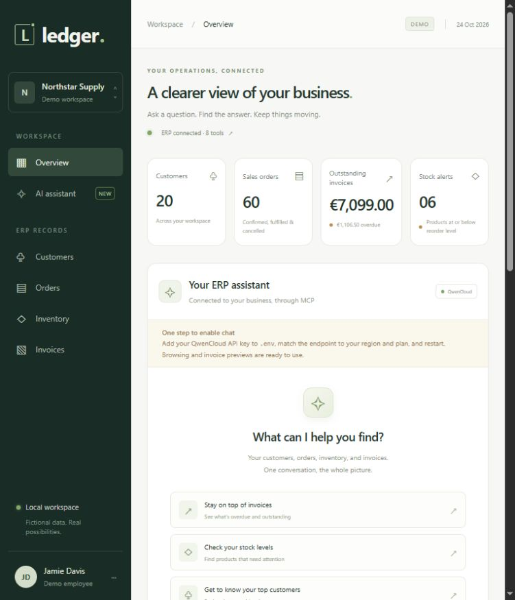

# smartERP — AI ERP Information Assistant

A local portfolio application that connects QwenCloud to a fictional office-supplies ERP through **real MCP tool calls**. Explore customers, orders, inventory, and invoices; ask questions across records; and create draft invoices only after reviewing and confirming an exact preview.

Python · FastAPI · SQLite · SQLAlchemy · Alembic · MCP · QwenCloud API · HTML/CSS/JavaScript



## Run locally

Install Python **3.12** and [uv](https://docs.astral.sh/uv/getting-started/installation/). From this directory:

```powershell
uv sync --locked
uv run python -m app.cli configure
uv run python -m app.cli init
uv run python -m app.cli serve
```

Open **http://127.0.0.1:8000**. The launcher starts the ERP first on port 8001, waits for readiness, then starts the browser app on port 8000. Press **Ctrl+C in the launch terminal** to stop both. Startup refuses occupied ports.

On Windows, `scripts/setup-local.ps1` runs installation/configuration/initialization, and `scripts/start-local.ps1` launches the services.

`configure` creates an ignored `.env` with a random internal service token and never overwrites an existing configuration. `init` applies migrations and seeds an empty database; it preserves existing demo records.

### Sign in

On your first visit, create your local workspace account with a username and a password of at least 8 characters. Setup is available only on this computer, and closes once the account exists. Subsequent visits show the sign-in page. Use **Sign out** in the sidebar to end your session.

The account persists in ignored `data/auth.sqlite`, separately from the ERP database. Passwords use uniquely salted PBKDF2-HMAC-SHA256 hashes with 600,000 iterations, following the [OWASP password-storage guidance](https://cheatsheetseries.owasp.org/cheatsheets/Password_Storage_Cheat_Sheet.html#pbkdf2). Credentials are never sent to QwenCloud. The dashboard, records, chat, and invoice actions require a server-side session. Sessions expire after one hour of inactivity or when the web service restarts; sign-out revokes the session immediately. Login is limited to ten failed attempts per five minutes in this single-account local app.

To change or recover your login, run this on the local computer; it prompts for the username and hidden password, and revokes existing sessions:

```powershell
uv run python -m app.cli set-login
```

### Enable QwenCloud

Set `DASHSCOPE_API_KEY` in `.env` and restart both services. `QWEN_MODEL` defaults to `qwen3.7-plus`; change it if your API account uses another compatible model. The model default was checked against [QwenCloud's model documentation](https://docs.qwencloud.com/developer-guides/getting-started/model-selection).

Use the key from your **qwencloud.com** console. No local model installation or GPU is needed. The default is QwenCloud's Singapore pay-as-you-go endpoint. Your key must come from the same region and access plan as the endpoint. [QwenCloud endpoints](https://docs.qwencloud.com/developer-guides/getting-started/regions)

```dotenv
DASHSCOPE_API_KEY=your-key-here
QWEN_BASE_URL=https://ap-southeast-1.maas.qwencloudapi.com/compatible-mode/v1
QWEN_MODEL=qwen3.7-plus
QWEN_ENABLE_THINKING=false
```

For another region, replace `ap-southeast-1` with its region ID, such as `eu-central-1` for Frankfurt, and use a key created there. For QwenCloud Token Plan, use `https://token-plan.maas.qwencloudapi.com/compatible-mode/v1` and the plan's own key instead. Choose a model available to that region/plan. A DashScope key issued by Alibaba Cloud Model Studio uses its own regional endpoint, not the QwenCloud domain; this project is configured for your qwencloud.com account.

`QWEN_API_KEY` is accepted as an alternative and takes precedence if present. To use `DASHSCOPE_API_KEY`, leave `QWEN_API_KEY` absent rather than setting a blank override. Legacy Claude settings are ignored. Existing configuration and the ERP database are preserved during migration.

The optional `QWEN_ENABLE_THINKING=true` mode preserves returned reasoning between model calls without displaying it in the interface. Thinking is disabled by default for the information-assistant workflow. Use a model that supports non-streaming Chat Completions and the chosen thinking setting.

The application makes paid QwenCloud API calls only when chat is configured. It works without a key for ERP browsing and manual invoice previews through MCP. Missing credentials display a setup message; there are no simulated QwenCloud answers.

Other settings:

| Setting | Default / purpose |
| --- | --- |
| `INTERNAL_TOKEN` | Random token shared by both services; minimum 32 characters |
| `DATABASE_URL` | Absolute SQLite file under `data/erp.sqlite` |
| `ERP_URL` | `http://127.0.0.1:8001` |
| `WEB_ORIGIN` | `http://127.0.0.1:8000`; use this exact browser address for action requests |
| `AUTH_DATABASE_PATH` | Account store, default `<project>/data/auth.sqlite`; independent of ERP data resets |
| `QWEN_TIMEOUT_SECONDS` | 60 seconds per model HTTP request |
| `QWEN_MAX_COMPLETION_TOKENS` | 4096 maximum output tokens per model call |
| `CHAT_TIMEOUT_SECONDS` | 180 seconds for an entire question, with at most eight model rounds |

For separate terminals or custom ports:

```powershell
uv run uvicorn app.erp_server:create_app --factory --host 127.0.0.1 --port 8001 --no-access-log
uv run uvicorn app.web:create_app --factory --host 127.0.0.1 --port 8000 --no-access-log
```

## Try it

- “Show Acme's recent orders and unpaid invoices.” The assistant should ask you to choose between Acme Office and Acme Studio.
- “Show Acme Office's (CUS-001) recent orders and unpaid invoices.”
- “Which products are running low on available stock?”
- “Which invoices are overdue, and what is the total outstanding amount?”
- “Who were our five biggest customers by order value last month?”
- “Prepare a draft invoice for order ORD-1042.”

Without an API key, search **ORD-1042** in Orders, open it, and choose **Prepare draft invoice**. Review customer, quantities, prices, total, and due date in the assistant panel. **Confirm draft invoice** creates exactly one draft; **Cancel** creates none. If the order was already used, choose another uninvoiced confirmed order, such as ORD-1043.

The initial seed has 20 customers, 30 products, 60 orders, and 40 invoices. Dates are anchored to the Paris business date when seeded. The sample balances and sales values are documented in [the demo guide](docs/DEMO.md).

To deliberately erase the configured demo records, previews, and audit history and reseed:

```powershell
# Stop both services first. This command deletes the configured ERP data.
uv run python -m app.cli reset --yes
```

## Verification

```powershell
uv run pytest -q
uv run ruff check app tests migrations
uv run ruff format --check app tests migrations
node --check static/app.js
node --check static/answer-format.js
node --check static/auth.js
node --test tests/answer-format.test.cjs
```

Automated tests cover account setup, password hashing, protected APIs, rate limits, session rotation, sign-out, password reset, expiry, business calculations, dashboard totals, actual Streamable HTTP MCP calls, QwenCloud's HTTP contract, malformed tool arguments, cloud errors, session isolation, stale previews, idempotency, and concurrent approval. Tests create their own migrated SQLite and account databases and subprocess services on temporary ports. They require no API key and do not modify the active demo database or login.

Eight Node tests also verify answer formatting, accessible triangle notes, table values, and safe handling of untrusted HTML and URLs.

The optional live acceptance command runs [12 fixed scenarios](docs/acceptance.json), including untrusted fixture text and the full approval flow:

```powershell
uv run python -m app.cli evaluate
```

It starts two disposable services with a separate temporary database, uses the configured QwenCloud key/model, confirms one synthetic invoice, and cleans up its processes. It never resets or writes to the active ERP. Results are saved to ignored `docs/live-results.json`; a missing API key produces an explicit **skipped** result. These checks were **not run against live QwenCloud during migration**, because the key had not been configured locally.

GitHub Actions is configured for Python 3.12 on Windows and Ubuntu; remote CI has not been run from this workspace.

## Design and boundaries

See [architecture and API contracts](docs/ARCHITECTURE.md), [demo walkthrough](docs/DEMO.md), and [verification record](docs/VERIFICATION.md).

The web service owns conversations and talks to QwenCloud. The ERP service exclusively owns SQLite. Both browser reads and MCP tools reuse ERP business logic. The agent discovers its eight tool schemas through MCP; invoice confirmation is a separate authenticated REST operation and is never a model tool.

This is a **single-account localhost demo**, using fictional data and EUR net amounts. It includes a local username/password login. Multiple users, roles, public hosting, tax calculation, invoice issuing/emailing, payments, stock mutations, and real ERP integration are outside the MVP. Keep both listeners on localhost.

Browser sessions and QwenCloud conversations live in web-process memory. Restarting the web process clears them, and old session-bound action previews become inaccessible. A page reload clears the displayed chat but retains the server's conversation context and reloads that session's recent action cards. Idle sessions expire after one hour. Pending previews expire after 15 minutes. Confirmed invoices and audit events persist in SQLite.

Dependencies are pinned transitively in `uv.lock`. This implementation uses the official **MCP Python SDK 1.30 maintenance line**, bounded below version 2, with its tested FastMCP and ClientSession APIs. See the [official v1 documentation](https://py.sdk.modelcontextprotocol.io/v1/) when extending it. QwenCloud uses a small HTTPX adapter for its HTTPS Chat Completions API. The Anthropic dependency was removed. Chat messages and relevant ERP tool results are sent to QwenCloud when you ask a question; invoice confirmation is handled entirely by the local backend.

