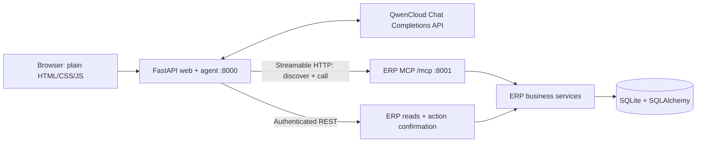

# Architecture and contracts

## Ownership

- `app/services.py` owns queries, integer-cent calculations, preview snapshots, and invoice transactions. The ORM and migrations are confined to the ERP side and management commands.
- `app/erp_server.py` exposes read routes and the eight typed MCP tools. It mounts the official SDK's stateless Streamable HTTP application and manages its lifespan.
- `app/gateway.py`, `app/agent.py`, and `app/web.py` handle transport, QwenCloud orchestration, browser sessions, and the public interface. There is no SQL execution tool or arbitrary ERP mutation tool.

## Browser API

All payloads are JSON. Resources are `customers`, `orders`, `stock`, and `invoices`. IDs are stable strings such as `CUS-001`, `SKU-004`, and `ORD-1042`.

| Method and route | Input / response |
| --- | --- |
| `GET /api/auth/status` | Public: `setup_required`, `authenticated`, and signed-in `username` if any |
| `POST /api/auth/setup` | Loopback-only first-run `{username, password}`; creates the sole account and a fresh session |
| `POST /api/auth/login` | `{username, password}`; issues an authenticated HTTP-only session cookie |
| `POST /api/auth/logout` | Revokes the current session and deletes its cookie |
| `POST /api/chat` | `{message}` → `{answer, references, tool_activity, pending_actions, error?, history_reset?}` |
| `GET /api/erp/{resource}` | Bounded filters → `{items, total, limit, offset, filters, aggregates, as_of, currency}` |
| `GET /api/erp/{resource}/{id}` | Full record, with invoice/order lines where applicable |
| `GET /api/dashboard` | Counts, stock-alert count, outstanding and overdue cents |
| `GET /api/session` | `llm_configured`, `llm_provider`, `llm_model`, and current session's latest 20 action cards |
| `POST /api/actions/prepare` | `{order_id}` → action preview, using the same MCP tool as QwenCloud |
| `POST /api/actions/{id}/confirm` | No body → `{action, invoice}` |
| `POST /api/actions/{id}/cancel` | No body → `{action}` |
| `GET /health` | ERP readiness, discovered tool count, `llm_configured`, `llm_provider`, `llm_model`; no secrets |

Collection filters: `q` is a literal case-insensitive ID/name search (customer search also includes email); `limit` is 1–100 and `offset` is 0–100000. Orders support `customer_id`, `status`, and inclusive `date_from`/`date_to`. Invoices also support inclusive `due_before` and `overdue=true`; date ranges refer to issue dates. Stock supports `low_stock=true`. Unknown filters, inappropriate active filters, invalid statuses, reversed dates, and out-of-range pagination are rejected.

Invoice `aggregates` cover every matching invoice before pagination. The UI shows a page of eight records. The small fictional dataset is loaded for filtering in the service layer; a production version should move this filtering and grouping into paginated SQL queries.

Domain errors use `{error: {code, message}}`: 404 for missing records/session-inaccessible actions, 409 for invalid state, 422 for invalid query, 403 for rejected browser origin/session, 401 for missing internal authentication, and 503 for unavailable ERP. FastAPI request-body validation uses its standard 422 `detail` response.

## MCP tools

`search_customers`, `get_customer_overview`, `list_orders`, `get_order`, `list_stock`, `list_invoices`, `get_sales_summary`, and `prepare_invoice` are the complete catalog. Input types generate JSON schemas; outputs require structured JSON dictionaries. Domain failures become MCP error results. The gateway discovers names, descriptions, and input schemas through MCP. The adapter in `app/llm.py` converts these into QwenCloud function tools (`type: function`, `function.parameters`).

Each chat opens an MCP connection with its own browser session header. The invoice preparation tool reads this session from the trusted transport request context. A session ID is never an argument that the model can choose. MCP discovery occurs at web startup and is retried if the ERP was initially unavailable.

The QwenCloud loop supplies a Paris business date in a system message, dispatches allowlisted tools, and returns `role: tool` messages with matching `tool_call_id` values. Tool arguments must parse to a JSON object; malformed arguments and unknown tools produce error results without dispatch. Truncated/filtered tool requests and duplicate call IDs are rejected. The loop runs for at most eight model rounds, with a configurable 180-second whole-request deadline. Model HTTP calls default to 60 seconds, with one retry for HTTP 429 or server errors; MCP calls retain a 30-second read timeout. Authentication, quota, connection, timeout, and malformed-response errors are shown without exposing raw provider errors or credentials.

The provider uses the configured HTTPS `QWEN_BASE_URL` and `QWEN_MODEL`; key lookup accepts `QWEN_API_KEY` first, then `DASHSCOPE_API_KEY`. No model request occurs at startup or on health checks. `llm_configured` means a key is configured, not that the provider has validated the key, region, quota, or model access. Thinking is disabled by default. When enabled, the adapter sends `enable_thinking` and `preserve_thinking`, preserves returned `reasoning_content` in server-only conversation history, and returns only the answer, source records, and tool activity to the browser.

Conversation turns are serialized per browser session and stored only in memory. Complete exchanges are committed to history only after a model answer. A failed partial turn is discarded. When history exceeds 120,000 serialized characters, the next request clears it and reports `history_reset`. Tool references come from recognized ID fields in successful ERP outputs, not arbitrary model-generated URLs. The UI renders text with DOM text nodes rather than HTML.

## Approval and concurrency

Preparation verifies a nonempty confirmed/fulfilled order with no invoice. It stores the exact customer and order-line snapshots, net total, today's draft date, a due date 30 days later, an expiry, and a hash of source data. It changes no business record.

Confirm and Cancel are outside the MCP catalog. The web app requires the configured browser Origin on every POST and forwards a server-side bearer token plus the session header to the ERP. The cookie is HTTP-only, SameSite Strict, and Secure when using an HTTPS origin. The sidebar displays the authenticated local account.

All workspace APIs require an authenticated session and return 401 when signed out; page requests redirect to `/login`. `app/auth.py` owns the single account in a separate ignored SQLite file. Passwords use a random 16-byte salt and PBKDF2-HMAC-SHA256 with 600,000 iterations. Initial setup is loopback-only; an atomic singleton insert prevents competing setup requests from replacing the account. Login creates a fresh random session token; failed attempts are limited to ten per five minutes (HTTP 429). Conversations and authentication share the one-hour idle session lifecycle. Logout removes the server-side session. The local `set-login` command replaces credentials and rotates an account version checked on authenticated requests, revoking earlier sessions. Authentication validation errors never echo supplied passwords. Credentials are never supplied to the agent.

The ERP starts `BEGIN IMMEDIATE` before reading an action. This serializes SQLite writers across processes. It checks ownership, state, expiry, current business date, eligibility, and source fingerprint. It then inserts the draft, changes action state, and adds the audit event in one transaction. A database uniqueness constraint on order ID also prevents multiple invoices for the same order.

Repeating a confirmed action returns its existing invoice. Competing previews produce one confirmed action and one stale action. Repeated cancellation is idempotent; confirmation after cancellation fails. Expired or changed previews are recorded as expired/stale and require new preparation. Inventory is never modified by invoice operations.

SQLite uses foreign keys, WAL, and a busy timeout. Both HTTP services require an internal token of at least 32 characters before startup. ERP health is publicly readable locally; every other ERP route, including `/mcp`, requires that token. The web service restricts Host headers and sets CSP, no-store, nosniff, and referrer headers. These controls support the local demo; public deployment needs real identity and authorization.

